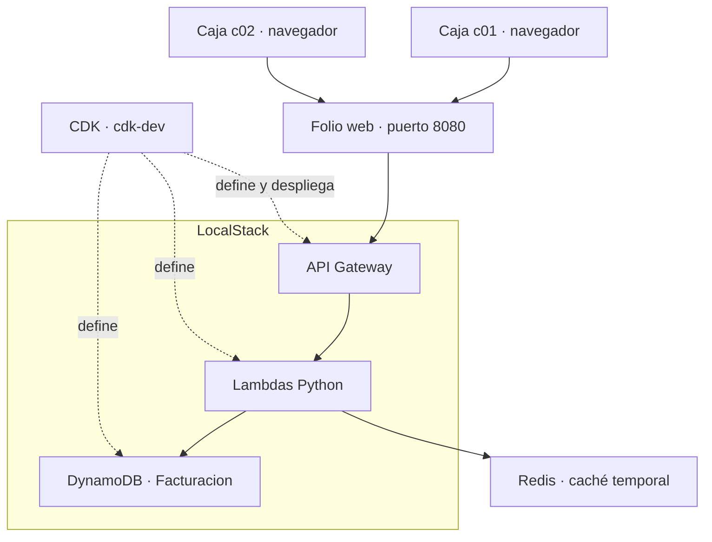

# Arquitectura

Los navegadores actúan como clientes ligeros. El servicio web entrega archivos
y reenvía `/api` al API Gateway local. Las Lambdas realizan las operaciones del
negocio; DynamoDB conserva los registros y Redis mantiene copias temporales.

## Single Table Design

Es un requisito del proyecto final del profesor. Las claves genéricas permiten
guardar entidades diferentes sin exigir los mismos atributos.

| Entidad | PK | SK |
| --- | --- | --- |
| Producto | PRODUCTO#id | DATOS |
| Cliente | CLIENTE#identificación | PERFIL |
| Caja | CONFIG#CAJAS | CAJA#id |
| Factura | FACTURA#uuid | DOCUMENTO |
| Solicitud | SOLICITUD#caja#uuid | RESULTADO |

Cada factura incorpora cliente y productos tal como se vendieron. Esta
desnormalización controlada permite conservar la historia y leer el documento
sin reconstruirlo mediante uniones con maestros actuales.

| Necesidad | Acceso |
| --- | --- |
| Detalle por ID | GetItem en la tabla |
| Catálogo y directorio | Query en GSI1, particiones de catálogo/directorio |
| Listar cajas | Query en CONFIG#CAJAS |
| Facturas de un cliente | GSI1PK = CLIENTE#identificación |
| Facturas de una caja | GSI2PK = CAJA#id |
| Facturas de un día | GSI3PK = VENTAS#DIA#AAAA-MM-DD |

Los historiales ordenan por fecha UTC y UUID, con el más reciente primero.
Los GSI proyectan resúmenes; el detalle se recupera por la clave de factura.
Los listados admiten 1 a 25 registros y cursores ligados a los filtros. Los GSI
tienen consistencia eventual; el detalle puede consultarse por ID.

## Confirmación e idempotencia

El navegador persiste un UUID y el cuerpo exacto antes del POST. El servidor
consulta primero el resultado de esa solicitud. Si existe y corresponde a la
misma intención, devuelve la factura original.

Para una venta nueva lee los maestros, comprueba versiones y caja activa y
calcula centavos enteros con Decimal y HALF_UP por línea. Una transacción agrupa
factura, resultado de solicitud y condiciones sobre los datos usados; una
condición fallida impide guardar parcialmente la venta.

Un fallo de red no demuestra que la escritura falló. La terminal conserva la
venta incierta y reintenta con la misma solicitud. Un rechazo definitivo permite
revisar datos antes de crear otra intención. Los borradores se guardan por caja
y origen del navegador; no constituyen una cola de ventas sin conexión.

## Cache-Aside

La aplicación busca en Redis un detalle cacheable. En un miss lee DynamoDB y
almacena la copia con TTL: producto 60 s y factura 300 s. Al actualizar un producto
se invalida su clave después de guardar el cambio. Un dato corrupto o un fallo
de Redis provoca lectura desde DynamoDB.

Crear/reintentar facturas, consultar clientes y ejecutar listados/historiales no
usa caché. Las ventas verifican precios actuales directamente en DynamoDB.

## Operación

La web comparte origen con el proxy; el cliente no necesita conocer ApiId ni DNS
interno de Docker. El stage prod se publica por el SDK después del despliegue,
evitando el conflicto observado al actualizar AWS::ApiGateway::Stage en
LocalStack 4.14. Los deployments anteriores se conservan.

El entorno recuperado del autor usa FacturacionServiciosStack y una tabla
existente. Un clon nuevo usa FacturacionStack y crea su tabla. La configuración
app/local-config.json pertenece a cada equipo y no se versiona.
