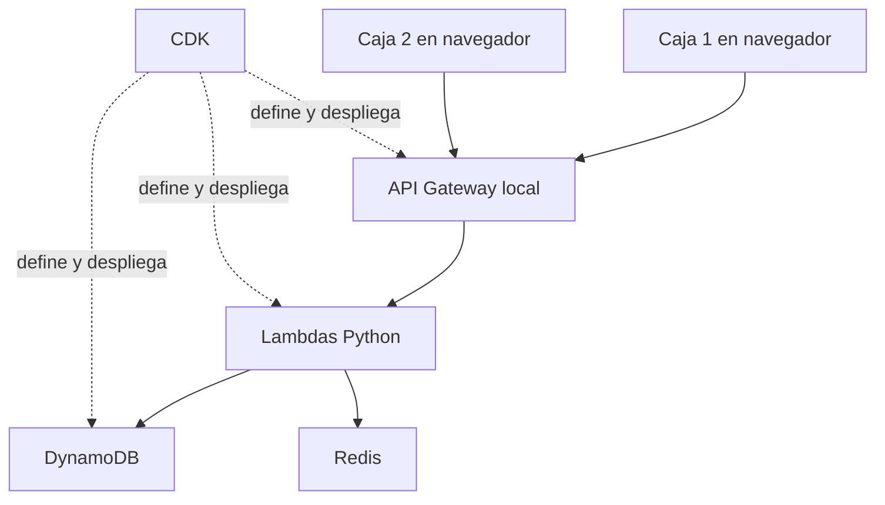

# Diseño del sistema centralizado de facturación con NoSQL

Universidad del Magdalena · Ingeniería de Sistemas · Bases de Datos NoSQL  
Versión 1 del diseño · 11 de noviembre de 2026

## Propósito y decisión de arquitectura

Desarrollaremos un prototipo académico para registrar las ventas de un comercio desde varias cajas conectadas a un computador central. Cada caja utilizará una interfaz web ligera. El equipo central ejecutará API Gateway, Lambda y DynamoDB mediante un emulador AWS, junto con Redis y el entorno de desarrollo CDK en Docker.

Cada factura conservará en un solo ítem los datos del cliente, los productos vendidos y los valores aplicados. DynamoDB será la fuente de verdad. Redis acelerará las consultas de productos y facturas, con expiración y comportamiento definido ante fallos. El diseño parte de los patrones de acceso y utiliza una sola tabla para las entidades del sistema.

El documento define la primera versión, sus claves e índices, contratos de API, reglas de consistencia y criterios de prueba. Describe el comportamiento que se implementará; no representa una aplicación ya ejecutada o validada.

## Alcance de la primera versión

La demostración tendrá un comercio, dos cajas y un equipo central en una red local. Se usarán datos ficticios y moneda COP. Las cantidades serán enteras entre 1 y 9999; el carrito admitirá hasta 50 productos distintos. Los precios del catálogo se expresarán antes del impuesto y cada producto tendrá una tasa configurable para el ejercicio. Se admitirán precios unitarios de 0 a 1000000000 centavos y tasas de 0 a 10000 puntos básicos. Los importes agregados deberán permanecer dentro del rango de enteros exactos de JavaScript. Los nombres se limitarán a 120 caracteres y el cuerpo HTTP a 64 KiB; estos límites son decisiones del prototipo.

Se implementarán las siguientes funciones:

- Crear, consultar, listar y actualizar productos del catálogo.
- Registrar, consultar, listar y actualizar clientes.
- Identificar la caja y el operador declarado de cada venta.
- Capturar un carrito, calcular sus valores en el servidor y registrar la factura completa.
- Consultar una factura por identificador y mostrar un comprobante imprimible desde el navegador.
- Consultar facturas por cliente y período, por caja y período, o por día del comercio.
- Reintentar una venta sin crear una segunda factura.
- Consultar el estado de DynamoDB y Redis y mostrar la procedencia de las lecturas en la vista de diagnóstico.

Los actores serán el cajero, que registra ventas y consulta comprobantes, y el administrador, que mantiene el catálogo y revisa el historial. En esta primera demostración la selección del operador identifica la operación, pero no constituye un sistema de autenticación ni de autorización. El equipo central se utilizará en un entorno de demostración controlado, sin publicación en Internet.

La integración DIAN, la numeración fiscal, las notas crédito, las devoluciones, el inventario, el procesamiento de pagos, el trabajo sin conexión, la sincronización entre sedes y la autenticación de producción quedan fuera de esta versión. La emisión tendrá alcance académico; el comprobante deberá indicarlo. Una integración fiscal real requiere un proyecto adicional de habilitación y validación [7].

## Objetivos verificables

1. Registrar dos ventas simultáneas desde cajas diferentes, conservando correctamente sus datos.
2. Recuperar una factura completa sin consultar el catálogo o el cliente para reconstruirla.
3. Resolver los listados definidos mediante `Query` e índices, sin `Scan` en los flujos habituales.
4. Demostrar una lectura desde DynamoDB seguida de una lectura desde Redis para la misma clave.
5. Demostrar que una solicitud repetida genera una sola factura.
6. Mantener el registro de ventas disponible cuando Redis no responda, siempre que DynamoDB esté disponible.
7. Recrear el entorno a partir del repositorio y ejecutar pruebas unitarias reproducibles.

## Arquitectura y responsabilidades

| Componente | Responsabilidad | Decisión de implementación |
|---|---|---|
| Interfaz web | Catálogo, carrito, clientes, historial y comprobante | HTML, CSS y JavaScript como primera opción; consumo HTTP de la API |
| API Gateway | Publicar rutas HTTP | API REST creada por CDK en el emulador local |
| Lambda de catálogo | Validar y consultar productos y clientes | Python con acceso a DynamoDB y Redis según la operación |
| Lambda de facturación | Calcular y registrar ventas y consultar facturas | Python con escrituras transaccionales y control de reintentos |
| DynamoDB | Conservar catálogo, clientes, cajas, facturas y solicitudes | Una tabla con PK y SK y tres índices globales secundarios |
| Redis | Caché temporal de productos y facturas | Cache-Aside con TTL y tiempos de espera acotados |
| CDK y Docker Compose | Definir y desplegar el entorno | Adaptación del proyecto base del profesor [1] |



Los clientes acceden a la API; no se conectan directamente a DynamoDB ni a Redis. Para una interfaz alojada en otro origen se configurará CORS con el origen concreto de desarrollo. La adaptación de la red Docker deberá permitir que las Lambdas resuelvan el servicio `redis`; el nombre fijo de red del ejemplo del profesor se ajustará al proyecto.

Los tres servicios de Compose describen la estructura de soporte. El emulador puede crear contenedores adicionales para ejecutar las Lambdas. El contenedor `cdk-dev` sirve para desarrollar y desplegar; las solicitudes de los cajeros se ejecutan en las Lambdas.

El equipo central es un punto único de fallo en esta versión: si se apaga, las cajas no registran ventas hasta recuperarlo. La persistencia entre reinicios se verificará en el emulador elegido; no se presupone que el volumen Docker conserve todos los recursos de AWS emulados. El proyecto base advierte que puede ser necesario repetir bootstrap y deploy. Los scripts de datos permiten reconstruir la demostración, pero no equivalen a recuperar ventas reales. La conservación histórica y la idempotencia presuponen que la tabla y sus registros siguen existiendo.

## Entidades y conservación histórica

| Entidad | Información principal | Regla de actualización |
|---|---|---|
| Producto | ID, nombre, precio en centavos, tasa de impuesto, activo y versión | Actualizable mediante control de versión |
| Cliente | ID, tipo y número de identificación de demostración, nombre y versión | Actualizable sin alterar facturas anteriores |
| Caja | ID, nombre y estado activo | Cajas iniciales cargadas por un script de datos |
| Factura | ID, fecha, caja, operador declarado, cliente, líneas, impuestos y totales | Inmutable tras su registro en esta versión |
| Solicitud | Clave de reintento, hash de intención e ID de factura | Se crea junto con la factura; no se modifica ni expira en esta versión |

La factura copia el nombre y la identificación del cliente y, por cada producto, su nombre, versión, cantidad, precio y tasa utilizados. Esa duplicación es deliberada: expresa cómo ocurrió la venta. Las pantallas de detalle histórico utilizarán esa copia, aunque cambien los registros maestros.

Los clientes se identificarán mediante una clave canónica, por ejemplo `CC#90000001`, usando datos ficticios. El número es una cadena para conservar ceros iniciales. Se validarán los caracteres permitidos y se reservará el separador `#`. El tipo y número de identificación serán inmutables; corregirlos requerirá registrar otro cliente. Se cargará además un cliente de demostración `GENERAL` para ventas sin cliente específico.

Los productos usarán UUID y tendrán un campo `version` entero. El ID de factura también será UUID; su referencia visible será `DEMO-<UUID>`. Se evita prometer un consecutivo fiscal y no se requiere un contador central para emitir la demostración.

## Patrones de acceso

Las frecuencias son estimaciones iniciales del uso del comercio, no mediciones ni cantidades exigidas por el profesor. `F` representa el identificador de factura, `C` el de cliente, `T` el de caja, `P` el de producto, `U` el UUID de solicitud, `D` el día local y `Z` una fecha UTC normalizada.

| ID | Pregunta u operación | Entidad | Operación y acceso | Frecuencia |
|---|---|---|---|---|
| AP01 | Dame un producto por su ID | Producto | GetItem en PRODUCTO#P y DATOS | Alta |
| AP02 | Dame el catálogo paginado por nombre | Producto | Query en GSI1 con CATALOGO#PRODUCTOS | Alta |
| AP03 | Dame un cliente por su identificación | Cliente | GetItem en CLIENTE#C y PERFIL | Alta |
| AP04 | Dame el directorio de clientes por nombre | Cliente | Query en GSI1 con DIRECTORIO#CLIENTES | Media |
| AP05 | Dame las cajas configuradas | Caja | Query en PK CONFIG#CAJAS y prefijo CAJA# | Baja |
| AP06 | Dame la factura completa F | Factura | GetItem en FACTURA#F y DOCUMENTO | Alta |
| AP07 | Dame las facturas de C entre dos fechas | Factura | Query en GSI1 con CLIENTE#C y rango de GSI1SK | Media |
| AP08 | Dame las facturas de T entre dos fechas | Factura | Query en GSI2 con CAJA#T y rango de GSI2SK | Media |
| AP09 | Dame las facturas del día D del comercio | Factura | Query en GSI3 con VENTAS#DIA#D | Media |
| AP10 | ¿Ya registramos la solicitud U de T? | Solicitud | GetItem consistente en SOLICITUD#T#U y RESULTADO | Alta al reintentar |
| AP11 | Crea un producto o cliente sin sobrescribir otro | Producto o cliente | PutItem con condición de inexistencia | Baja |
| AP12 | Actualiza un producto o cliente si su versión coincide | Producto o cliente | UpdateItem condicional e incremento de versión | Baja |
| AP13 | Registra la factura y el resultado de solicitud juntos | Factura y solicitud | TransactWriteItems con condiciones y verificaciones de versión | Alta |

Los listados devolverán un cursor y un tamaño de página de hasta 25 resultados. El cursor conservará la `LastEvaluatedKey` y estará ligado al tipo de consulta y a sus filtros; el servidor validará su estructura. Continuará con `ExclusiveStartKey` [5]. Los historiales tendrán orden descendente por fecha. El catálogo y el directorio usarán orden ascendente por nombre normalizado e ID para desempatar.

La primera versión permite cada filtro de historial por separado. Una búsqueda libre por fragmentos de texto, combinaciones arbitrarias de filtros y reportes agregados sobre todo el historial requerirán nuevos patrones. No se resolverán silenciosamente mediante recorridos completos de la tabla.

## Diseño de claves de la tabla

Nombre lógico sugerido: `Facturacion`. El nombre físico podrá ser asignado por CDK. PK y SK serán atributos de tipo String. Todos los registros tendrán `tipo_entidad`, `schema_version`, `creado_en` y, cuando corresponda, `actualizado_en` y `version`.

PK es la clave de partición, que identifica un grupo de registros; SK es la clave de ordenamiento, que distingue y ordena los registros dentro de ese grupo. La pareja PK y SK identifica un ítem de forma única. Un GSI ofrece otra pareja de claves para consultar esos mismos datos desde otro criterio. `GetItem` recupera un ítem por su clave completa y `Query` recupera un conjunto usando una partición y, opcionalmente, una condición de ordenamiento.

| Tipo de registro | PK | SK |
|---|---|---|
| Producto | PRODUCTO#P | DATOS |
| Cliente | CLIENTE#C | PERFIL |
| Caja | CONFIG#CAJAS | CAJA#T |
| Factura | FACTURA#F | DOCUMENTO |
| Solicitud de venta | SOLICITUD#T#U | RESULTADO |

### Índices globales secundarios

| Registro que aparece en el índice | Índice | Clave de partición | Clave de ordenamiento |
|---|---|---|---|
| Producto | GSI1 | CATALOGO#PRODUCTOS | PRODUCTO#nombre_normalizado#P |
| Cliente | GSI1 | DIRECTORIO#CLIENTES | CLIENTE#nombre_normalizado#C |
| Factura para historial de cliente | GSI1 | CLIENTE#C | FACTURA#Z#F |
| Factura para historial de caja | GSI2 | CAJA#T | FACTURA#Z#F |
| Factura para historial del comercio | GSI3 | VENTAS#DIA#D | FACTURA#Z#F |

Los atributos físicos serán `GSI1PK`, `GSI1SK`, `GSI2PK`, `GSI2SK`, `GSI3PK` y `GSI3SK`. GSI1 se sobrecarga: agrupa entidades diferentes bajo particiones con prefijos distintos. GSI2 y GSI3 contienen facturas; los registros que no tengan sus claves no aparecerán en ellos.

Los tres índices tienen una razón independiente: consultar por cliente, consultar por caja y consultar el día completo del comercio. Un mismo ítem de factura solo puede aportar una pareja de claves a cada GSI. Esta solución evita crear registros de relación adicionales para cada consulta, a cambio de mantener tres índices.

Se usará proyección `INCLUDE`. Para GSI1 se incluirán `tipo_entidad`, `nombre`, `activo`, `version`, `precio_unitario_centavos`, `impuesto_bps`, `factura_id`, `fecha_utc`, `caja_id`, `cliente_id` y `total_centavos`. GSI2 y GSI3 incluirán el resumen de factura: `factura_id`, `fecha_utc`, `caja_id`, `cliente_id` y `total_centavos`. DynamoDB proyecta las claves de tabla e índice automáticamente. El documento completo y sus líneas se leerán desde la tabla al abrir el detalle; no se duplicarán en todas las proyecciones.

El catálogo y el directorio concentrados en una partición de índice son una decisión para el volumen pequeño del prototipo. El historial global se divide por día. Una ampliación de volumen requerirá medir carga y distribución y, si hace falta, dividir particiones. No se atribuye escalabilidad ilimitada a esta configuración local.

### Fechas y consistencia

Se almacenará el instante como UTC con ancho fijo, por ejemplo `2026-11-12T03:15:00.000Z`. El campo `fecha_local` se calculará en `America/Bogota`; para ese instante será `2026-11-11`. La agrupación diaria usará esa fecha local, no la fecha UTC.

Los rangos de historial se convertirán a UTC y utilizarán un intervalo de inicio incluido y fin excluido. La implementación construirá condiciones de clave sobre `FACTURA#Z#F` y probará los límites de medianoche, sin usar filtros de tabla para seleccionar la fecha.

Los GSI tienen consistencia eventual [3]. Una factura recién guardada puede tardar en aparecer en los listados; la interfaz mostrará inmediatamente el resultado devuelto por la creación y permitirá refrescar el historial. Para recuperar el documento recién emitido y para resolver reintentos se usará lectura fuertemente consistente en la tabla principal.

## Registro de una venta y control de duplicados

1. El cajero selecciona un cliente y agrega productos. La interfaz conserva el ID y la versión de cada producto mostrado.
2. Al confirmar, la interfaz crea un UUID de solicitud y conserva la intención pendiente hasta recibir una respuesta definitiva. La intención contiene caja, operador declarado, cliente y líneas con producto, cantidad y versión esperada. No guarda datos sensibles en la clave de solicitud.
3. El servidor valida la forma del JSON y obtiene un hash SHA256 de una representación canónica de la intención. Las líneas se ordenan por producto; se rechazan productos repetidos en líneas diferentes y cantidades no enteras o no positivas.
4. Antes de consultar precios actuales, lee la solicitud con consistencia fuerte. Si ya existe y el hash coincide, recupera y devuelve la factura original. Si el hash difiere, responde 409 y exige otra clave para otra intención.
5. Si es una solicitud nueva, verifica la caja activa y obtiene de DynamoDB los productos y el cliente. Estas lecturas no usan la caché. Si una versión de producto difiere de la confirmada por el cajero, responde 409 con el carrito actualizado y solicita reconfirmación.
6. Calcula los importes, asigna el UUID de factura, fecha del servidor y versión de esquema. El cliente nunca impone el total de la factura.
7. Ejecuta una transacción que contiene dos Put condicionales: factura y solicitud. Ambos exigen que el registro no exista. Añade ConditionCheck para las versiones de los productos, del cliente y el estado de la caja.
8. Si alguna condición falla, no se guarda una venta parcial. Ante una colisión por solicitud, relee el registro para devolver el resultado que ganó la carrera. Ante conflictos transitorios, aplica reintentos acotados; si no se resuelven, devuelve un error recuperable y conserva la clave de solicitud.
9. Devuelve 201 y la factura confirmada. Una repetición ya registrada devuelve 200 con `replayed: true`. Una respuesta perdida después del commit se resuelve repitiendo la misma intención y clave.

Las condiciones de versión dentro de la transacción cubren el intervalo entre la lectura y la escritura: un cambio concurrente del catálogo obliga a recalcular y reconfirmar. Los registros objetivo de los ConditionCheck son distintos de los dos registros creados. Con 50 productos, un cliente y una caja, el máximo previsto es de 54 acciones, dentro del límite de 100 acciones de DynamoDB [4].

La solicitud guardará su hash y la referencia a la factura en la misma transacción. No tendrá TTL en la primera versión, para mantener el control de duplicados durante toda la demostración. El token de idempotencia de la API transaccional de AWS tiene una ventana limitada; el registro persistente de solicitud es la garantía de negocio adoptada [4].

Un borrador confirmado que cambia de productos, cantidades, cliente o versiones se convierte en otra intención y recibe otra clave. Si solo se reintenta por desconexión, se reutilizan la clave y el cuerpo originales. Los cambios de catálogo no deben impedir devolver una factura que ya se había registrado.

## Dinero y documento de factura

Los importes se guardarán como enteros en centavos de COP. Por ejemplo, 10000 centavos representan COP 100,00. El contrato usará nombres explícitos terminados en `_centavos` para evitar confundir unidades. La interfaz se encargará del formato monetario.

La tasa se guardará en puntos básicos: `1000` representa 10,00 %. El cálculo de impuesto por línea usará Decimal construido desde enteros o cadenas, con redondeo HALF_UP a un centavo. No se convertirá a float. Decimal ofrece control explícito sobre la precisión y el redondeo [6].

- Base de línea: precio unitario en centavos multiplicado por cantidad.
- Impuesto de línea: base multiplicada por impuesto_bps y dividida entre 10000, redondeada al entero más próximo con HALF_UP.
- Total de línea: base más impuesto de línea.
- Subtotal de factura: suma de las bases.
- Impuestos de factura: suma de los impuestos ya redondeados por línea.
- Total de factura: subtotal más impuestos.

El siguiente JSON muestra datos ficticios y una tasa ilustrativa del 10 %; no prescribe el tratamiento tributario de un producto real. Omite las claves de índices para facilitar su lectura, pero contiene la estructura del documento persistido.

```json
{
  "PK": "FACTURA#f001",
  "SK": "DOCUMENTO",
  "tipo_entidad": "FACTURA",
  "schema_version": 1,
  "factura_id": "f001",
  "referencia": "DEMO-f001",
  "fecha_utc": "2026-11-12T03:15:00.000Z",
  "fecha_local": "2026-11-11",
  "creado_en": "2026-11-12T03:15:00.000Z",
  "caja_id": "c01",
  "operador_declarado": "operador-demo-01",
  "cliente_id": "CC#90000001",
  "cliente": {
    "nombre": "Cliente de demostración",
    "tipo_documento": "CC",
    "numero_documento": "90000001",
    "version": 1
  },
  "moneda": "COP",
  "lineas": [
    {
      "producto_id": "p001",
      "nombre": "Producto de demostración",
      "version": 3,
      "cantidad": 2,
      "precio_unitario_centavos": 10000,
      "impuesto_bps": 1000,
      "base_centavos": 20000,
      "impuesto_centavos": 2000,
      "total_centavos": 22000
    }
  ],
  "subtotal_centavos": 20000,
  "impuestos_centavos": 2000,
  "total_centavos": 22000,
  "solicitud_id": "solicitud-demo-001"
}
```

Los IDs breves del ejemplo son didácticos; la aplicación generará UUID para factura, producto y solicitud. La combinación de cliente y sus prefijos se construirá de manera canónica, evitando repetir accidentalmente `CLIENTE#`.

Se validará el tamaño del ítem antes de escribirlo y se limitarán las longitudes de nombres e identificadores. Cada factura debe permanecer bajo el límite de 400 KB de DynamoDB [2]. Un documento demasiado grande se rechazará con un mensaje claro; no se dividirá silenciosamente en varios ítems. Cambios futuros agregarán campos y versiones de esquema, manteniendo lectores compatibles con la versión 1.

## Estrategia de caché

| Dato | Clave Redis | TTL inicial | Invalidación y uso |
|---|---|---|---|
| Detalle de producto | facturacion:v1:producto:P | 60 segundos | Borrar tras una actualización exitosa; uso de consulta y carrito |
| Factura inmutable | facturacion:v1:factura:F | 300 segundos | Expiración natural; la versión 1 no edita ni elimina facturas |

Se adopta Cache-Aside: leer Redis; si falta la clave, leer DynamoDB; guardar la respuesta y devolverla. La creación de facturas no depende de poblar la caché. Los historiales y los directorios no se cachearán inicialmente, para evitar invalidar múltiples listas tras cada venta o edición.

En una actualización de producto, primero se confirma el cambio condicional en DynamoDB y luego se intenta borrar su clave Redis. Una lectura concurrente podría repoblar una versión anterior; por ello se reconoce una ventana de desactualización acotada por el TTL. La verificación final de precio y versión al facturar usa DynamoDB y las condiciones transaccionales, por lo que la caché no decide el precio cobrado.

El cliente Redis tendrá tiempos de conexión y lectura acotados, inicialmente 200 ms cada uno, sin reintentos internos ilimitados. Una ausencia de clave, un fallo de conexión o un JSON de caché inválido se tratarán como miss y se registrarán en logs. Fallar al guardar o borrar caché no revierte una venta ya confirmada en DynamoDB.

El detalle incluirá información técnica de procedencia mediante un campo de diagnóstico o cabecera, por ejemplo `X-Data-Source: redis` o `dynamodb`. Se verá en la pantalla de diagnóstico y en Postman, sin mezclarla con los campos históricos de la factura.

## Contrato inicial de la API

| Método y ruta | Finalidad | Respuesta principal |
|---|---|---|
| GET /health | Revisar DynamoDB y Redis | 200 operativo o 503 degradado con detalle |
| POST /productos | Registrar un producto | 201 y producto |
| GET /productos?limit=25&cursor=... | Listar catálogo | 200 con items y next_cursor |
| GET /productos/{id} | Consultar producto | 200 o 404 |
| PUT /productos/{id} | Actualizar campos con versión esperada | 200, 404 o 409 |
| POST /clientes | Registrar un cliente | 201 o 409 si ya existe |
| GET /clientes?limit=25&cursor=... | Listar directorio | 200 con items y next_cursor |
| GET /clientes/{id} | Consultar cliente canónico | 200 o 404 |
| PUT /clientes/{id} | Actualizar nombre con versión esperada | 200, 404 o 409 |
| GET /cajas | Consultar cajas iniciales | 200 y listado |
| POST /facturas | Confirmar una venta | 201 nueva, 200 repetida o 409 en conflicto |
| GET /facturas/{id} | Recuperar documento completo | 200 o 404 |
| GET /clientes/{id}/facturas?desde=...&hasta=... | Historial de cliente | 200 con items y cursor |
| GET /cajas/{id}/facturas?desde=...&hasta=... | Historial de caja | 200 con items y cursor |
| GET /facturas?fecha=AAAA-MM-DD | Historial diario del comercio | 200 con items y cursor |

Los identificadores de cliente usados en rutas se codificarán con `encodeURIComponent`, dado que `#` tiene significado especial en una URL. Las rutas de historial admitirán también `limit` y `cursor`. Se recomienda limitar cada intervalo a 31 días en la primera versión. El historial global diario consulta una única partición; una vista de varios días requerirá iterar particiones explícitamente y no se incluye como una consulta única.

Ejemplo de intención de venta:

```json
{
  "solicitud_id": "UUID-generado-por-la-terminal",
  "caja_id": "c01",
  "operador_declarado": "operador-demo-01",
  "cliente_id": "CC#90000001",
  "lineas": [
    {"producto_id": "UUID-del-producto", "cantidad": 2, "version_esperada": 3}
  ]
}
```

El servidor validará `Content-Type: application/json`, estructura, tipos, longitudes, cantidades, identificadores y versiones. Responderá 400 ante JSON o campos inválidos; 404 ante referencias inexistentes; 409 ante versiones, estados o claves en conflicto; 413 cuando el cuerpo supere el límite de la aplicación; y 503 si no puede confirmar el almacenamiento. Una factura ya registrada se recuperará antes de volver a validar referencias que pudieron cambiar.

## Pruebas y criterios de aceptación

| Caso | Preparación | Resultado esperado |
|---|---|---|
| Venta válida | Cliente, caja y dos productos activos | Totales correctos y documento completo persistido |
| Reintento después de respuesta perdida | Repetir cuerpo y solicitud_id | Una factura y replay del mismo identificador |
| Reintentos simultáneos | Dos solicitudes idénticas concurrentes | Un único commit de negocio |
| Clave reutilizada con otra intención | Mismo ID y distinta cantidad | 409 sin crear otra factura |
| Precio cambia antes de confirmar | Incrementar versión del producto | 409 y reconfirmación del carrito |
| Precio cambia durante el registro | Cambiar versión entre lectura y transacción | Transacción rechazada, sin factura parcial |
| Primera lectura y segunda lectura | Dato en DynamoDB y clave Redis ausente | Primera desde DynamoDB; segunda desde Redis |
| Actualización de catálogo | Cambiar precio y borrar caché | Nueva consulta muestra nueva versión |
| Redis no disponible | Simular error o detener Redis en entorno de prueba | La venta se guarda; lecturas recurren a DynamoDB |
| DynamoDB no disponible | Simular fallo antes del commit | No se muestra confirmación de venta; reintento conserva clave |
| Conservación histórica | Cambiar cliente y producto tras una venta | Factura anterior conserva sus datos originales |
| Redondeo | Líneas con impuesto fraccionario | Totales coinciden con suma de líneas redondeadas |
| Historial y paginación | Más de 25 ventas y varias cajas y clientes | Sin omisiones ni duplicados en un conjunto de datos estable |
| Límite de día local | Venta alrededor de medianoche de Bogotá | Agrupación diaria y rangos correctos |
| Dos cajas | Emitir dos ventas diferentes simultáneas | Ambas confirmadas con identificadores distintos |
| Datos inválidos | Cantidad negativa, tipo inválido o producto repetido | Error de validación sin escritura parcial |

Las pruebas unitarias usarán pytest, moto y fakeredis. La conectividad, las condiciones transaccionales concurrentes, la propagación de índices y las rutas HTTP se comprobarán además contra el emulador. Un mock aprobado no sustituye la prueba del flujo completo. Los datos de demostración se cargarán con un script reproducible y serán ficticios.

## Orden de implementación

| Etapa | Trabajo | Evidencia para cerrarla |
|---|---|---|
| 1 | Adaptar Compose, CDK, tabla e índices | Entorno levantado y GET /health operativo |
| 2 | Implementar catálogo, clientes, cajas y datos iniciales | Consultas y cambios condicionales funcionando |
| 3 | Implementar cálculos y transacción de venta | Documento completo y reintentos sin duplicados |
| 4 | Implementar caché y fallos acotados | Hit, miss, expiración e invalidación demostrados |
| 5 | Implementar historiales y paginación | Consultas por cliente, caja y día sin Scan |
| 6 | Construir interfaz y comprobante | Venta completa desde dos terminales |
| 7 | Ejecutar pruebas y preparar sustentación | Resultados reproducibles, README y guion de demo |

La entrega final reunirá este diseño actualizado, el repositorio con infraestructura y pruebas, la demo local y la sustentación de decisiones. Las cantidades de terminales, límites y etapas de este documento son decisiones del proyecto; no se presentan como exigencias adicionales del profesor.

## Demostración propuesta

1. Levantar el entorno y mostrar el estado de los servicios.
2. Abrir Caja 1 y Caja 2 en navegadores y seleccionar los operadores de demostración.
3. Consultar un producto con caché vacía y repetir para mostrar hit.
4. Registrar ventas diferentes desde ambas cajas y abrir sus comprobantes.
5. Reenviar una de las intenciones y demostrar que devuelve la misma factura.
6. Cambiar el precio del catálogo y comprobar que la factura anterior conserva su precio.
7. Consultar los historiales de cliente, caja y día.
8. Simular la caída de Redis y mostrar que se sigue registrando en DynamoDB.
9. Ejecutar las pruebas y explicar claves, índices, snapshots, consistencia e idempotencia.

## Fuentes técnicas

[1] Charles Oliveros. Repositorio de Bases de Datos NoSQL, README y proyecto base. Referencia revisada en la fase inicial: rama main, commit 835ada8a. https://gitlab.com/caov_unimag/bd_no_sql

[2] AWS. Supported data types and naming rules in Amazon DynamoDB. Mapas, listas y límite por ítem. https://docs.aws.amazon.com/amazondynamodb/latest/developerguide/HowItWorks.NamingRulesDataTypes.html

[3] AWS. DynamoDB read consistency. Lecturas fuertes y consistencia eventual de GSI. https://docs.aws.amazon.com/amazondynamodb/latest/developerguide/HowItWorks.ReadConsistency.html

[4] AWS. Amazon DynamoDB Transactions How it works. Atomicidad, condiciones, límites y ventana de idempotencia. https://docs.aws.amazon.com/amazondynamodb/latest/developerguide/transaction-apis.html

[5] AWS. Paginating table query results in DynamoDB. LastEvaluatedKey y ExclusiveStartKey. https://docs.aws.amazon.com/amazondynamodb/latest/developerguide/Query.Pagination.html

[6] Python. decimal Decimal fixed point and floating point arithmetic. Se utilizará el runtime Python 3.11 del proyecto base. https://docs.python.org/3.11/library/decimal.html

[7] DIAN. Ser Facturador Electrónico. Referencia para distinguir el prototipo del proceso de habilitación fiscal. https://www.dian.gov.co/impuestos/factura-electronica/como-hacerlo/Paginas/ser-facturador-electronico.aspx
