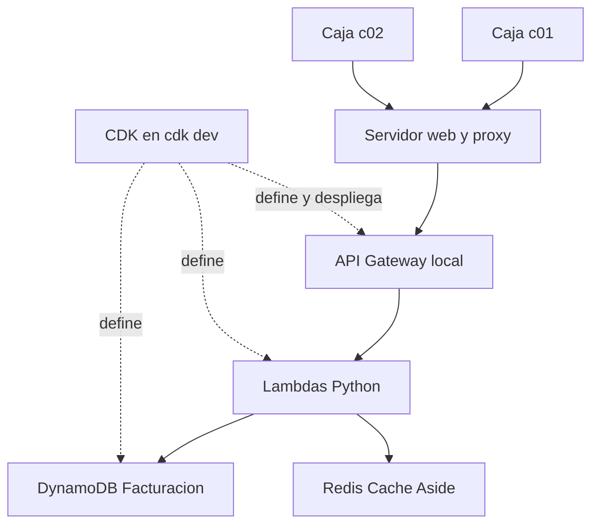

# Sistema centralizado de facturación con NoSQL

**Documento de diseño y verificación de Folio**\
Universidad del Magdalena · Ingeniería de Sistemas · Bases de Datos NoSQL\
Revisión del 14 de noviembre de 2026 · Etapa 7

## 1 Propósito y alcance

Folio es un sistema académico de facturación con ventas centralizadas desde varias cajas. Cada factura conserva cliente, productos, cantidades, impuestos y totales como un documento independiente en DynamoDB. Redis mantiene copias temporales de consultas repetidas. La aplicación funcional y sus pruebas fueron comprobadas en el entorno local del estudiante; este documento consolida la implementación para su entrega y defensa.

| Dato | Descripción |
|---|---|
| Institución | Universidad del Magdalena · Ingeniería de Sistemas |
| Asignatura | Bases de Datos NoSQL |
| Proyecto | Folio · Sistema centralizado de facturación |
| Revisión | 14 de noviembre de 2026 · Etapa 7 |
| Repositorio | https://github.com/EduaVergara/facturacion-nosql |
| Base de código revisada | Commit 8b72f7021d60182192ec701fd193626fc52fb40b |

### Objetivo verificable

Registrar ventas desde dos terminales, recuperar su documento histórico sin reconstruirlo con datos actuales y resolver reintentos sin duplicar la factura. Las lecturas habituales se diseñan por claves e índices, y el sistema conserva la operación con DynamoDB si Redis falla.

### Funciones implementadas

- Catálogo y clientes con creación, consulta, paginación y actualización por versión.
- Ventas con cálculo monetario en el servidor, transacción y solicitud persistente.
- Historial por cliente, caja y día de Colombia; comprobante consultable e imprimible.
- Interfaz web, diagnóstico, caché con TTL, pruebas y entorno Docker/CDK reproducible.

### Límite de la demostración

Se trabaja con un comercio, dos cajas configuradas y datos ficticios. El operador es declarado; no constituye autenticación ni autorización. No se implementan DIAN, autorización fiscal, inventario, pagos, devoluciones, sincronización entre sedes ni ventas sin conexión. El código es público en GitHub; la aplicación se ejecuta en el equipo central o su LAN, sin un despliegue público de la aplicación.

## 2 Arquitectura y responsabilidades

Los navegadores son clientes ligeros. El servidor web entrega HTML/CSS/JavaScript y reenvía /api al API Gateway del emulador. Las funciones Lambda ejecutan las reglas del negocio. DynamoDB conserva los datos; Redis acelera detalles cacheables. Los navegadores no acceden directamente a las bases de datos.

| Componente | Responsabilidad |
|---|---|
| Frontend | Punto de venta, catálogo, clientes, historial, comprobantes y estado local por caja. |
| Servidor web | Archivos permitidos y proxy del mismo origen; resuelve ApiId desde las salidas CDK. |
| API Gateway y Lambdas | Rutas HTTP, validación, lógica del catálogo y confirmación de ventas. |
| DynamoDB | Fuente de verdad: tabla Facturacion con PK/SK y tres GSI. |
| Redis | Cache-Aside para detalles de productos y facturas. |
| cdk-dev y CDK | Contenedor de desarrollo/despliegue; define tabla, funciones, permisos y API. |
| Docker Compose | Servicios emulador, redis, cdk-dev y frontend; LocalStack crea contenedores de ejecución Lambda. |

El proxy permite usar las mismas URLs desde los navegadores sin configurar el DNS interno de Docker. La publicación LAN debe habilitarse explícitamente. El equipo central sigue siendo un punto único de fallo: si se apaga o DynamoDB no está disponible, no se confirma una venta. La caída de Redis tiene un tratamiento diferente, pues su contenido es recuperable.

## 3 Modelo de datos y consultas

Single Table Design es un requisito explícito del proyecto final del profesor [1]. La implementación usa una tabla física llamada Facturacion. Las entidades se distinguen mediante claves genéricas y tipo_entidad; no requieren los mismos atributos. DynamoDB admite mapas y listas anidados, utilizados para conservar la factura como documento [2].

| Entidad | PK | SK |
|---|---|---|
| Producto | PRODUCTO#P | DATOS |
| Cliente | CLIENTE#C | PERFIL |
| Caja | CONFIG#CAJAS | CAJA#T |
| Factura | FACTURA#F | DOCUMENTO |
| Solicitud | SOLICITUD#T#U | RESULTADO |

P y F son UUID de producto y factura; C es la identificación canónica del cliente; T identifica la caja; U es el UUID de solicitud. La pareja PK/SK identifica un registro. Un cliente puede ser GENERAL o, por ejemplo, CC#90000001. El número es texto para conservar ceros iniciales.

| Registro / consulta | Índice y partición | Ordenamiento |
|---|---|---|
| Catálogo de productos | GSI1: CATALOGO#PRODUCTOS | PRODUCTO#nombre_normalizado#P |
| Directorio de clientes | GSI1: DIRECTORIO#CLIENTES | CLIENTE#nombre_normalizado#C |
| Facturas por cliente | GSI1: CLIENTE#C | FACTURA#Z#F |
| Facturas por caja | GSI2: CAJA#T | FACTURA#Z#F |
| Facturas por día | GSI3: VENTAS#DIA#D | FACTURA#Z#F |

Z es UTC con milisegundos y ancho fijo; D es el día local. GSI1 se sobrecarga con particiones de distintos tipos. GSI2/GSI3 solo contienen registros que tienen sus claves. Los índices proyectan resúmenes mediante INCLUDE, sin copiar las líneas completas de cada factura.

### Consistencia y paginación

Los detalles y el control de solicitudes usan GetItem con ConsistentRead=True en la tabla. Las consultas GSI son eventualmente consistentes [3]; una factura recién creada puede tardar en aparecer en un listado, aunque ya esté disponible por ID. Los listados usan LastEvaluatedKey y ExclusiveStartKey [4], con límite de 1 a 25 y cursores ligados al recurso y filtros.

Los historiales se ordenan por fecha/UUID descendente. El catálogo y directorio ordenan por nombre normalizado e ID. Los rangos incluyen el inicio y excluyen el final, duran como máximo 31 días y se convierten a UTC. La implementación utiliza UTC-5 para las ventas contemporáneas de Colombia.

## 4 Patrones de acceso implementados

Se catalogan 13 patrones: diez de consulta y tres de escritura. Crear o actualizar producto/cliente se agrupa por el mismo mecanismo de persistencia. Los patrones describen necesidades de datos; no cuentan cada lectura auxiliar ni equivalen a la cantidad de rutas HTTP.

| ID | Necesidad | Acceso implementado |
|---|---|---|
| AP01 | Producto por ID | GetItem: PRODUCTO#P / DATOS. |
| AP02 | Catálogo por nombre | Query GSI1: CATALOGO#PRODUCTOS. |
| AP03 | Cliente por identificación | GetItem: CLIENTE#C / PERFIL. |
| AP04 | Directorio de clientes | Query GSI1: DIRECTORIO#CLIENTES. |
| AP05 | Cajas configuradas | Query: CONFIG#CAJAS, prefijo CAJA#. |
| AP06 | Factura completa | GetItem: FACTURA#F / DOCUMENTO. |
| AP07 | Facturas de un cliente entre fechas | Query GSI1: CLIENTE#C y rango de SK. |
| AP08 | Facturas de una caja entre fechas | Query GSI2: CAJA#T y rango de SK. |
| AP09 | Ventas de un día del comercio | Query GSI3: VENTAS#DIA#D y rango. |
| AP10 | Solicitud ya registrada | GetItem fuerte: SOLICITUD#T#U / RESULTADO. |
| AP11 | Crear producto o cliente | PutItem con attribute_not_exists(PK). |
| AP12 | Actualizar si la versión coincide | PutItem del registro actualizado con condición de versión. |
| AP13 | Registrar factura y solicitud juntas | TransactWriteItems con dos Put y ConditionCheck. |

AP12 se documenta como PutItem condicional porque es la operación real del adaptador. El modelo conserva metadatos e incrementa version antes de sustituir el registro; la condición impide sobrescribir un cambio concurrente. El diseño inicial proponía UpdateItem, pero esa no es la llamada utilizada por el código revisado.

### Consultas que no se prometen

La búsqueda de productos/clientes en la interfaz filtra los registros cargados; Cargar más amplía ese conjunto. No hay búsqueda global por fragmentos, filtros históricos arbitrarios ni reportes agregados sobre toda la tabla. Los flujos habituales usan GetItem/Query; el Scan administrativo de respaldo no se presenta como patrón de consulta del negocio.

## 5 Venta atómica e importes exactos

- La terminal persiste solicitud_id y cuerpo antes del POST. Envía caja, operador declarado, cliente e IDs/cantidades/versiones de productos.
- El servidor valida la intención y calcula su hash SHA256 canónico. Antes de releer maestros, busca el resultado de la solicitud con lectura fuerte.
- Si ya existe con el mismo hash, devuelve la factura original. Un contenido distinto con la misma clave se rechaza con 409.
- Para una venta nueva consulta caja, cliente y productos directamente en DynamoDB. Un producto inactivo o con versión distinta obliga a revisar el carrito.
- Calcula totales y copia los datos usados a la factura. Una transacción crea factura y solicitud con condiciones de inexistencia y comprueba versiones/estado de maestros.
- Si una condición falla, no se guarda una venta parcial. Una colisión por solicitud se resuelve releyendo el resultado; los conflictos transitorios tienen reintentos acotados.

Una venta nueva devuelve 201; un reenvío válido devuelve 200 y replayed=true. El registro SOLICITUD no tiene TTL. El token AWS se mantiene estable durante los reintentos de una invocación, pero no sustituye el registro duradero de negocio: la ventana del token transaccional es de diez minutos [5]. La garantía depende de conservar factura y solicitud en DynamoDB.

| Límite del prototipo | Valor |
|---|---|
| Productos distintos / cantidad por línea | 1 a 50 / 1 a 9999 |
| Precio unitario / tasa | 0 a 1.000.000.000 centavos / 0 a 10.000 bps |
| Cuerpo HTTP / documento generado | 64 KiB / 350 KiB como margen del prototipo |
| Importes agregados | Enteros dentro de 2^53 - 1 |
| Acciones por venta de 50 productos | 54: dos Put y 52 verificaciones |

## 6 Dinero y documento histórico

Los importes son centavos COP. impuesto_bps=1000 representa 10 %. El servidor usa Decimal y HALF_UP por línea, sin convertir a float [6]. La terminal usa BigInt para estimaciones; el valor definitivo es el confirmado por el servidor. El ejemplo calculado con el modelo del código se entrega en docs/ejemplos/Factura_demostracion.json; no se presenta como lectura de una venta real.

| Línea de demostración | Base COP | Impuesto COP | Total COP |
|---|---|---|---|
| 3 cuadernos a 5.000, tasa 10 % | 15.000 | 1.500 | 16.500 |
| 3 carpetas a 3.000, tasa 0 % | 9.000 | 0 | 9.000 |
| Total | 24.000 | 1.500 | 25.500 |

### Información conservada en cada factura

El documento incluye factura_id, referencia, solicitud_id, caja_id, operador_declarado, cliente_id, copia del cliente y una lista de líneas con su nombre, versión, cantidad, precio, tasa, base, impuesto y total. También conserva moneda, subtotal, impuestos, total, fecha UTC, día local y schema_version. Las claves GSI permiten recuperar el resumen desde diferentes criterios.

La referencia DEMO-UUID identifica el comprobante académico; no constituye un consecutivo fiscal. Un cambio de nombre, precio o identificación en los maestros no reescribe una factura emitida. La API no ofrece editar o eliminar el documento histórico.

Agregar campos comerciales nuevos requiere definir su semántica, conservar compatibilidad con facturas anteriores y ajustar validadores, caché y pruebas. El campo schema_version identifica esa evolución; la flexibilidad de listas y mapas no implica aceptar documentos sin validación.

## 7 Redis y comportamiento ante fallos

El patrón es Cache-Aside o Lazy Loading: la aplicación consulta Redis y, ante un miss, lee DynamoDB y guarda una copia con TTL. Este patrón se elige para acelerar detalles repetidos y conservar a DynamoDB como fuente de verdad. No se afirma una mejora de latencia medida: las pruebas demuestran procedencia y comportamiento funcional, no un benchmark.

| Dato | Clave | TTL |
|---|---|---|
| Producto | facturacion:v1:producto:ID | 60 s |
| Factura | facturacion:v1:factura:ID | 300 s |

- Un hit válido devuelve la copia; un miss recupera DynamoDB y vuelve a poblar Redis.
- Se valida esquema, ID e importes de la entrada. Un JSON corrupto o incoherente se descarta y se consulta DynamoDB.
- Después de actualizar un producto se invalida su copia. La invalidación y DynamoDB no forman una transacción distribuida; una lectura cacheada puede ser temporalmente antigua.
- Las ventas y reenvíos verifican directamente DynamoDB. Los clientes, listados e historiales no usan la caché.
- Los tiempos por socket Redis se limitan a 0,2 s y se desactivan reintentos implícitos del cliente. Esto no es una garantía de latencia total de la solicitud.
- Si Redis no responde, las lecturas cacheables continúan desde DynamoDB. Un health degradado no significa por sí solo que DynamoDB haya fallado.

### Estado de la terminal

El navegador mantiene un borrador por caja/origen y congela el cuerpo de una confirmación pendiente. Tras una respuesta incierta conserva ese cuerpo para reintentar. Valida que el comprobante corresponda a la intención antes de vaciar el carrito. Si no puede persistir el estado local, evita iniciar una venta que no pueda recuperar.

Una modificación observada desde otra pestaña de la misma caja bloquea la edición hasta recargar. Se recomienda una pestaña por caja: este control local no es un bloqueo distribuido entre todos los equipos. Una caja no cambia mientras tenga carrito o confirmación pendiente. Los nombres se muestran como texto, no como HTML.

### Historia y evolución

La factura conserva una copia de cliente y productos de la venta. Los cambios en los maestros o la expiración de Redis no reconstruyen ese documento. schema_version permite identificar la versión; agregar campos futuros exige ajustar validadores, contratos y pruebas. La flexibilidad documental no elimina esa responsabilidad.

## 8 API y uso de la aplicación

Existen 15 combinaciones método/ruta en diez rutas. El conteo incluye health y excluye OPTIONS de CORS y /ready del servidor web. La interfaz utiliza el mismo origen mediante /api. GET /facturas?fecha=AAAA-MM-DD es un filtro de una ruta existente, no otro endpoint.

| Ruta | Métodos | Finalidad |
|---|---|---|
| /health | GET | Estado DynamoDB/Redis. |
| /productos | GET, POST | Listar o crear productos. |
| /productos/{id} | GET, PUT | Detalle y actualización por versión. |
| /clientes | GET, POST | Directorio y creación. |
| /clientes/{id} | GET, PUT | Detalle y cambio de nombre. |
| /cajas | GET | Cajas configuradas. |
| /facturas | GET, POST | Historial diario y confirmación. |
| /facturas/{id} | GET | Documento histórico completo. |
| /clientes/{id}/facturas | GET | Historial del cliente en un rango. |
| /cajas/{id}/facturas | GET | Historial de la caja en un rango. |

### Recorrido del cajero

- Abrir http://localhost:8080/?caja=c01 o ?caja=c02 con el servidor local iniciado.
- Declarar operador, seleccionar cliente y agregar productos. Crear cliente si hace falta, conservando su identificación como texto.
- Revisar cantidades e importe estimado; confirmar y comprobar referencia, caja, cliente, líneas y totales del documento del servidor.
- Abrir Historial por día, cliente o caja. Para incluir un día completo, elegir como Hasta el día siguiente. Cargar más conserva el cursor de esa consulta.
- Abrir el comprobante e imprimir desde el navegador. La vista previa y el guardado como PDF requieren revisión manual.

Ante pérdida de conexión no se descarta la solicitud ni se inicia otra venta para resolver la anterior. Se utiliza Reintentar confirmación. Un rechazo definitivo de catálogo habilita Revisar carrito y precios. El manual de usuario desarrolla estos pasos y la diferencia entre cliente, operador y caja.

## 9 Validación y aceptación

La evidencia conocida procede de la salida completa de Verificar-Etapa6.ps1 y de las capturas compartidas por el estudiante. La ejecución de GitHub Actions mostró succeeded en todos sus pasos. Se distinguen esas evidencias de cualquier ejecución nueva de etapa 7, que solo se considera realizada cuando exista su resultado.

| Comprobación | Resultado conocido |
|---|---|
| Pruebas Python en Docker | 208 passed y 147 subtests passed. |
| Pruebas Node | 23 correctas; cero fallos. |
| Despliegue y servicios | UPDATE_COMPLETE; DynamoDB, tres GSI y Redis en estado ok. |
| Facturación HTTP | Totales de servidor, persistencia, reenvíos y dos cajas comprobados. |
| Historiales | GSI1/GSI2/GSI3, orden, límites, día de Colombia y cursores comprobados. |
| Caché | Hit/miss, TTL, invalidación, corrupción y continuidad/restauración de Redis comprobados en etapa 4. |
| Interfaz manual | Comprobante c01 de 25.500 COP e historial; comprobante c02 de 34.650 COP visibles. |
| GitHub Actions | Job Pruebas aprobado: backend/CDK, terminal y configuración Compose. |

### Aceptación que falta confirmar

- Ejecutar la nueva verificación integrada de etapa 7 en el Docker del estudiante y conservar su resumen.
- Revisar la vista previa de impresión o el PDF exportado; no basta con abrir el comprobante en pantalla.
- Ejecutar el arranque desde un clon nuevo en el equipo de un compañero y registrar versión/resultado.
- Incorporar capturas con datos ficticios y comprobar enlaces/documentos después del nuevo commit.

CIERRE_MANUAL.md presenta los comandos de prueba por separado para ejecutarlos desde VS Code. Se conservan las salidas localmente y se registran resultados observados. La comprobación offline exige restaurar Redis incluso si falla. Impresión e instalación independiente se revisan por separado; una prueba fallida impide declarar el cierre aprobado.

La CI usa moto, fakeredis y código Lambda inline para inspeccionar la plantilla CDK. Complementa los checks del emulador, pero no demuestra por sí sola el despliegue real, el comportamiento visual o el funcionamiento bajo una carga de producción.

## 10 Entrega y defensa técnica

| Entregable del profesor | Material preparado |
|---|---|
| Documento de diseño | Este informe PDF y su versión Markdown, con AP, claves, índices y decisión de caché. |
| Código fuente | Repositorio público con Docker, CDK, Lambdas, interfaz y tests. |
| Demostración funcional | Guion de demo, manual de usuario y verificaciones automáticas/manuales. |
| Sustentación | Preguntas y respuestas ligadas a la implementación y a sus límites. |

La decisión central consiste en diseñar alrededor de consultas conocidas: la factura se lee como un documento, los historiales utilizan índices y una solicitud persistente liga el reintento a una sola venta. El coste es duplicación controlada, mantenimiento de índices y diseño previo de claves. Las pruebas funcionales respaldan el prototipo; el rendimiento a gran escala y la disponibilidad de producción requieren otro proceso de validación.

### Referencias y procedencia

[1] Repositorio académico del profesor, bd_no_sql, README: Proyecto final, stack obligatorio, entregables y criterios de evaluación. Base revisada: commit 835ada8a. https://gitlab.com/caov_unimag/bd_no_sql

[2] AWS. Supported data types and naming rules in Amazon DynamoDB. Mapas/listas y restricciones por ítem. https://docs.aws.amazon.com/amazondynamodb/latest/developerguide/HowItWorks.NamingRulesDataTypes.html

[3] AWS. DynamoDB read consistency. https://docs.aws.amazon.com/amazondynamodb/latest/developerguide/HowItWorks.ReadConsistency.html

[4] AWS. Paginating table query results in DynamoDB. https://docs.aws.amazon.com/amazondynamodb/latest/developerguide/Query.Pagination.html

[5] AWS. Amazon DynamoDB Transactions: How it works. Atomicidad, condiciones y ventana del token. https://docs.aws.amazon.com/amazondynamodb/latest/developerguide/transaction-apis.html

[6] Python Software Foundation. decimal, runtime 3.11. https://docs.python.org/3.11/library/decimal.html

Implementación revisada: app/infra, app/lambdas, frontend, scripts y tests del repositorio Folio. Revisión documental del 14 de noviembre de 2026. Los límites numéricos, TTL y rutas descritos corresponden al código del prototipo, no a una configuración universal de DynamoDB o Redis.
